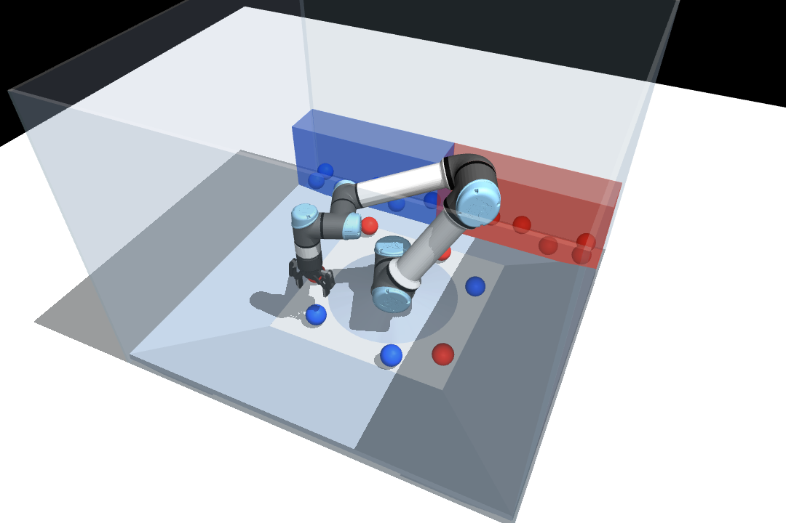

# Учебный проект: сортировка шаров манипулятором UR5e в MuJoCo

Манипулятор UR5e с захватом Robotiq 2F-85 должен сортировать синие и красные шары: брать
шары, покоящиеся на столе, и перекладывать их в контейнер своего цвета. Шары подаются
в рабочую зону сверху, катятся, сталкиваются и останавливаются в произвольных местах.
Всё работает в симуляторе MuJoCo под ROS 2 Jazzy, реальное оборудование не нужно.

Это демонстрационная задача курса «Объектно-ориентированное программирование. От набора
скриптов — к архитектуре робота». Репозиторий открывается по этапам. Сейчас (этап R0)
в нём есть окружение, сцена, описание робота и вспомогательные узлы. Архитектура системы,
заготовки заданий и эталонные решения появятся по ходу курса — после сроков
соответствующих заданий.



## Что есть сейчас

```text
.
├── docker/                          # образ и Compose-файл рабочего окружения
├── simulation/
│   ├── ball_sorting/                # сцена MuJoCo: generate_scene.py → scene.xml
│   └── models/mujoco_menagerie/     # модели UR5e и Robotiq 2F-85
└── src/
    ├── ball_sorting_interfaces/     # сообщения DetectedTarget и DetectedTargets
    ├── ball_sorting_description/    # xacro манипулятора с захватом; устанавливает сцену и модели
    ├── ball_sorting_bringup/        # параметры контроллеров и вспомогательных узлов, launch-файлы
    ├── targets_launcher/            # Python: подача шаров в рабочую зону
    └── targets_detector/            # Python: имитация технического зрения
```

`build/`, `install/` и `log/` создаёт colcon при сборке.

## Узлы и интерфейсы

| Узел или процесс | Назначение | Интерфейсы |
| --- | --- | --- |
| `/targets_launcher` | подаёт шары из контейнеров в рабочую зону раз в 2–5 с, пока в ней меньше 5 шаров | service `/targets_launcher/launch` (`std_srvs/srv/SetBool`): `true` — включить подачу, `false` — выключить |
| `/targets_detector` | имитирует техническое зрение: 10 раз в секунду публикует шары, которые покоятся на столе в рабочей зоне, в порядке обнаружения | topic `/targets_detector/detected_targets` (`ball_sorting_interfaces/msg/DetectedTargets`) |
| процесс `ros2_control_node` | MuJoCo, `/controller_manager` и контроллеры | action `/arm_controller/follow_joint_trajectory` — траектории шести суставов руки; action `/gripper_controller/gripper_cmd` — захват; topic `/joint_states` — состояние суставов и привода захвата |

Оба вспомогательных узла получают истинное состояние шаров из симулятора.

## Запуск

Нужны Docker Engine и Docker Compose. Для окна MuJoCo нужен сеанс X11; если его нет,
запускайте с `headless:=true`.

Из корня проекта соберите образ и откройте оболочку в контейнере:

```bash
docker compose -f docker/compose.yaml up -d --build
docker compose -f docker/compose.yaml exec course bash
```

В контейнере соберите пакеты и запустите стенд — симуляцию, контроллеры и вспомогательные
узлы:

```bash
cd /workspace
colcon build --symlink-install
source install/setup.bash
ros2 launch ball_sorting_bringup stand.launch.py
```

Во втором терминале выполните ещё раз `docker compose … exec course bash` и
`source install/setup.bash`, затем:

```bash
# включить подачу шаров (false — выключить)
ros2 service call /targets_launcher/launch std_srvs/srv/SetBool "{data: true}"

# шары, пригодные для захвата
ros2 topic echo /targets_detector/detected_targets

# контроллеры ros2_control
ros2 control list_controllers
```

Аргументы запуска:

| Аргумент | По умолчанию | Назначение |
| --- | --- | --- |
| `headless` | `false` | `true` — без окна MuJoCo |
| `sim_speed_factor` | `1.0` | скорость симуляции относительно реального времени; все узлы работают по времени симуляции |

Только симуляция и контроллеры, без вспомогательных узлов:

```bash
ros2 launch ball_sorting_bringup simulation.launch.py
```

## Команды манипулятору из командной строки

Руку двигает контроллер траекторий: goal — точки траектории в углах шести суставов.
Пример: повернуть основание на 0.5 рад относительно начальной позы за 3 с.

```bash
ros2 action send_goal /arm_controller/follow_joint_trajectory control_msgs/action/FollowJointTrajectory \
  "{trajectory: {joint_names: [shoulder_pan_joint, shoulder_lift_joint, elbow_joint, wrist_1_joint, wrist_2_joint, wrist_3_joint],
    points: [{positions: [3.0759, -2.1611, 1.6805, -1.0902, -1.5708, -0.5657], time_from_start: {sec: 3}}]}}"
```

Начальная поза — те же углы, но первый равен 2.5759.

Захватом управляет положение ведущего звена: 0 — раскрыт, 0.8 — сжат.

```bash
# сжать
ros2 action send_goal /gripper_controller/gripper_cmd control_msgs/action/ParallelGripperCommand \
  "{command: {name: [gripper_right_driver_joint], position: [0.8]}}"

# раскрыть
ros2 action send_goal /gripper_controller/gripper_cmd control_msgs/action/ParallelGripperCommand \
  "{command: {name: [gripper_right_driver_joint], position: [0.0]}}"
```

## Тесты

```bash
colcon test
colcon test-result --verbose
```

Тесты `targets_detector` и `targets_launcher` написаны на pytest. Они проверяют фильтры
обнаружения, порядок обнаружения, выбор шара для подачи и скорость подачи.

## Сцена

Сцена описана в [simulation/README.md](simulation/README.md). Файл `scene.xml` создаёт
скрипт `generate_scene.py`; размеры сцены меняют в нём. Сцену можно открыть в просмотрщике
MuJoCo без ROS:

```bash
/opt/ros/jazzy/opt/mujoco_vendor/bin/simulate simulation/ball_sorting/scene.xml
```
