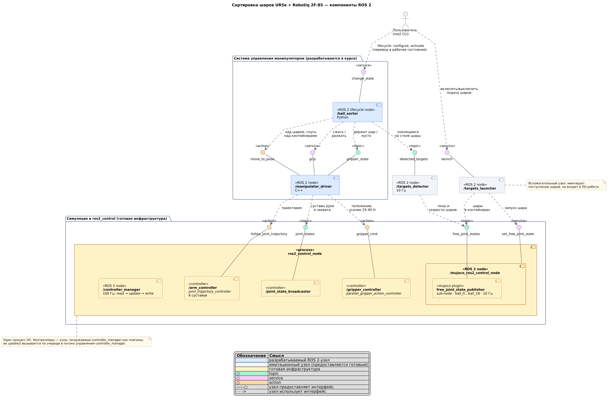

# Архитектура системы

Документ описывает архитектуру решения задачи сортировки шаров на уровне ROS 2-узлов: какие узлы входят в систему, за что отвечает каждый и как они взаимодействуют через topics, services и actions. Внутреннее устройство разрабатываемых узлов — классы, паттерны, параметры — здесь не описано: его проектируют и реализуют по ходу курса.

## Диаграмма компонентов

Исходник диаграммы — [component_diagram.puml](component_diagram.puml). Пересобрать её можно командой `java -jar plantuml.jar -tsvg component_diagram.puml`, для этого нужен Graphviz.

| Элемент | Обозначение |
| --- | --- |
| Разрабатываемый ROS 2-узел | синий компонент |
| Имитационный узел (предоставляется готовым) | серый компонент |
| Готовая инфраструктура | жёлтый компонент |
| «process» | процесс ОС; вложенные компоненты — ROS 2-узлы и плагины внутри него |
| «controller» | контроллер ros2_control: отдельный lifecycle-узел, который controller_manager загружает как плагин |
| «mujoco plugin» | плагин `mujoco_ros2_control`: код внутри узла `/mujoco_ros2_control_node`, использует его sub-node |
| Topic, service, action | кружок интерфейса со стереотипом «topic», «service» или «action» — зелёный, сиреневый или оранжевый. На диаграмме — короткое имя без namespace узла |
| Сплошная линия к кружку | узел **предоставляет** интерфейс: публикует topic, обслуживает service, исполняет action |
| Пунктирная стрелка к кружку | узел **использует** интерфейс: подписывается на topic, вызывает service, отправляет goal action |

## Узлы

| Узел | Язык | Ответственность |
| --- | --- | --- |
| `/ball_sorter` — разрабатывается | Python, lifecycle-узел | Координирует задачу. Переход `activate` запускает работу: захват раскрывается, а манипулятор остаётся в начальной позе, пока не появится цель. Переход `deactivate` останавливает работу. Узел берёт первый шар из `detected_targets` и ведёт этапы: выбор цели → подвод в точку над шаром → спуск → захват → перенос → сброс. Если цель пропала во время подвода или захват потерял шар, узел возвращается к выбору цели. С оборудованием напрямую не работает: использует только интерфейсы `/manipulator_driver` и `/targets_detector`. В его параметрах — всё, что относится к сцене задачи: позы сброса над контейнерами, параметры подвода и потери цели. |
| `/manipulator_driver` — разрабатывается | C++ | Адаптер манипулятора — единственный разрабатываемый узел, который работает с ros2_control. Получив goal `move_to_pose`, решает обратную задачу кинематики UR5e для позы захвата, проверяет достижимость и пределы суставов, строит суставную траекторию и исполняет её через `arm_controller`. Новый goal вытесняет исполняемый. По сервису `grip` сжимает или раскрывает захват через `gripper_controller`; сервис сразу отвечает, принята ли команда. Публикует `gripper_state` — состояние захвата в терминах задачи; определяет его по командам и по положению и усилию привода захвата из `/joint_states`. О шарах и контейнерах ничего не знает: его параметры описывают только манипулятор и захват. |
| `/targets_detector` — готовый | Python | Имитирует систему технического зрения. В реальном роботе на его месте был бы узел машинного зрения с тем же интерфейсом `detected_targets`. Получает истинные позы и скорости шаров из `free_joint_states` и 10 раз в секунду публикует только шары, пригодные для захвата: покоящиеся, лежащие на столе и находящиеся в рабочей зоне. Шары идут в порядке обнаружения: новая детекция добавляется в конец массива, туда же попадает шар, который сдвинулся и снова остановился. |
| `/targets_launcher` — готовый, вспомогательный | Python | Имитирует поступление шаров и в ПО робота не входит. По сервису `launch` включает или выключает подачу. Каждые 2–5 с выбирает случайный шар из лежащих в контейнерах и переносит его в точку подачи (−0.25, 0, 0.9) со случайной скоростью, направленной вниз и от ближайшей стенки. Подача пропускается, если в рабочей зоне уже 5 шаров или больше. Положения шаров берёт из истинного состояния симулятора и от `/targets_detector` не зависит. |
| процесс `ros2_control_node` — готовый | — | Один процесс, в котором работают несколько ROS 2-узлов. `/controller_manager` выполняет цикл управления 100 раз в секунду: read → update → write. Три контроллера — `/joint_state_broadcaster`, `/arm_controller`, `/gripper_controller` — загружаются как плагины, их `update()` вызывается по очереди в потоке управления. Узел `/mujoco_ros2_control_node` подключает MuJoCo как аппаратный интерфейс и обслуживает сервисы симуляции, например `set_free_joint_state`. Плагин `free_joint_state_publisher` публикует позы и скорости шаров. |

## Интерфейсы

| На диаграмме | Полное имя | Вид | Тип | Предоставляет | Использует |
| --- | --- | --- | --- | --- | --- |
| `change_state` | `/ball_sorter/change_state` | service (стандартный lifecycle) | `lifecycle_msgs/srv/ChangeState` | `/ball_sorter` | пользователь (`ros2 lifecycle set`) |
| `move_to_pose` | `/manipulator_driver/move_to_pose` | action | `ball_sorting_interfaces/action/MoveToPose` | `/manipulator_driver` | `/ball_sorter` |
| `grip` | `/manipulator_driver/grip` | service | `std_srvs/srv/SetBool` | `/manipulator_driver` | `/ball_sorter` |
| `gripper_state` | `/manipulator_driver/gripper_state` | topic | `ball_sorting_interfaces/msg/GripperState` | `/manipulator_driver` | `/ball_sorter` |
| `detected_targets` | `/targets_detector/detected_targets` | topic | `ball_sorting_interfaces/msg/DetectedTargets` | `/targets_detector` | `/ball_sorter` |
| `launch` | `/targets_launcher/launch` | service | `std_srvs/srv/SetBool` | `/targets_launcher` | пользователь |
| `follow_joint_trajectory` | `/arm_controller/follow_joint_trajectory` | action | `control_msgs/action/FollowJointTrajectory` | `/arm_controller` | `/manipulator_driver` |
| `joint_states` | `/joint_states` | topic | `sensor_msgs/msg/JointState` | `/joint_state_broadcaster` | `/manipulator_driver` |
| `gripper_cmd` | `/gripper_controller/gripper_cmd` | action | `control_msgs/action/ParallelGripperCommand` | `/gripper_controller` | `/manipulator_driver` |
| `set_free_joint_state` | `/mujoco_ros2_control_node/set_free_joint_state` | service | `mujoco_ros2_control_msgs/srv/SetFreeJointState` | `/mujoco_ros2_control_node` | `/targets_launcher` |
| `free_joint_states` | `/free_joint_state_publisher/free_joint_states` | topic | `mujoco_ros2_control_msgs/msg/FreeJointStateArray` | `free_joint_state_publisher` | `/targets_detector`, `/targets_launcher` |

Собственные сообщения и action задачи лежат в пакете `ball_sorting_interfaces`:

- [DetectedTarget.msg](../src/ball_sorting_interfaces/msg/DetectedTarget.msg), [DetectedTargets.msg](../src/ball_sorting_interfaces/msg/DetectedTargets.msg) — обнаруженные шары: имя, цвет и центр в системе основания манипулятора;
- [GripperState.msg](../src/ball_sorting_interfaces/msg/GripperState.msg) — состояние захвата: `OPEN`, `MOVING`, `HOLDING` или `CLOSED_EMPTY`. `header.stamp` — время, когда состояние вычислено;
- [MoveToPose.action](../src/ball_sorting_interfaces/action/MoveToPose.action) — движение захвата в позу точки TCP. Способ движения задаётся полем `motion_type` (`JOINT` или `LINEAR`); новый goal вытесняет исполняемый, и тот завершается со статусом `ABORTED`.

## Ключевые решения

1. **Два разрабатываемых узла.** Логика задания (`/ball_sorter`, Python) отделена от работы с манипулятором (`/manipulator_driver`, C++). Кинематику и состояние захвата можно проверять на GoogleTest без симулятора, логику задания — на pytest с заглушкой вместо `/manipulator_driver`.
2. **Единственная граница с оборудованием.** Всё взаимодействие с ros2_control — траектории, захват, `/joint_states` — сосредоточено в `/manipulator_driver`. `/ball_sorter` использует только `move_to_pose`, `grip` и `gripper_state` и получает обратную связь в терминах задачи: «держит объект», «пусто». Параметры оборудования — усилие сжатия, пороги в единицах привода — в логику задания не попадают. Замена захвата или переход с контроллеров ros2_control на драйвер производителя затрагивают один узел.
   *Отвергнуто:* `/ball_sorter` напрямую обращается к `gripper_controller` и `/joint_states`; для захвата заводится отдельный узел.
3. **Один action движения, без именованных поз.** Все движения задаются позой захвата через `move_to_pose`. Знания о сцене — позы сброса над контейнерами, высота подхода — хранятся в параметрах `/ball_sorter`. Знания о манипуляторе — ветвь решения обратной задачи кинематики, пределы суставов — в параметрах `/manipulator_driver`. Отдельной рабочей позы нет: из начальной позы манипулятор сразу движется к первой цели.
   *Отвергнуто:* второй action с именованными позами («сложен», «готов», «над контейнером») в параметрах драйвера — тогда драйвер знал бы о сцене задачи.
4. **Способ движения — поле `motion_type` в goal.** `LINEAR` — для вертикального спуска к шару и подъёма после захвата, `JOINT` — для остальных движений.
   *Отвергнуто:* параметр узла (не позволяет совместить прямолинейный спуск с суставными переходами); автоматический выбор по длине движения (поведение становится неявным).
5. **Штатные контроллеры ros2_control.** `joint_trajectory_controller` интерполирует движение шести суставов, писать свою интерполяцию не нужно. `parallel_gripper_action_controller` принимает положение и `max_effort`; признак `stalled` в результате показывает, что пальцы упёрлись в объект.
6. **Захват — сервис-команда и topic состояния.** Сжатие длится около 0.5–1 с, поэтому `grip` не ждёт окончания движения: он сразу отвечает, принята ли команда, а итог приходит в `gripper_state` — `MOVING` → `HOLDING` или `CLOSED_EMPTY`, при раскрытии `MOVING` → `OPEN`. Синхронное ожидание внутри обработчиков в ROS 2 потребовало бы отдельных групп обратных вызовов и многопоточного executor. Переносимый шар движется и в `detected_targets` не публикуется, поэтому о его потере `/ball_sorter` узнаёт только из `gripper_state`.
   *Отвергнуто:* сервис, отвечающий по завершении сжатия; action `grip` — он единообразнее с `move_to_pose`, но сложнее для двоичной команды.
7. **Отбор целей — в восприятии.** `/targets_detector` публикует только шары, покоящиеся на столе в рабочей зоне, в порядке обнаружения. Поэтому `/ball_sorter` не проверяет скорость и высоту шаров и берёт первый шар массива. Восприятие решает, какие объекты пригодны для захвата, логика задания — какой из них брать. Реальная система технического зрения должна соблюдать тот же контракт `detected_targets`.
8. **Запуск задачи — lifecycle-переходом.** Отдельного сервиса активации нет. Launch-файл запускает `/ball_sorter` и выполняет `configure`; пока узел не активен, он не реагирует на шары. `ros2 lifecycle set /ball_sorter activate` запускает задачу, `deactivate` останавливает её и отменяет текущее движение.
9. **Подача шаров не зависит от восприятия.** `/targets_launcher` считает шары по истинным координатам из симулятора, поэтому изменения в `/targets_detector` не влияют на имитацию окружения. Подача ограничена пятью шарами в рабочей зоне: иначе зона заполняется шарами, лежащими вплотную, и пальцы захвата задевают соседние шары.

## Что откроется дальше

Репозиторий открывается по этапам. Заготовка заданий по `/manipulator_driver`, эталонные реализации узлов, их параметры, launch-файл всей системы и инструменты проверки появятся по ходу курса — после сроков соответствующих заданий.
